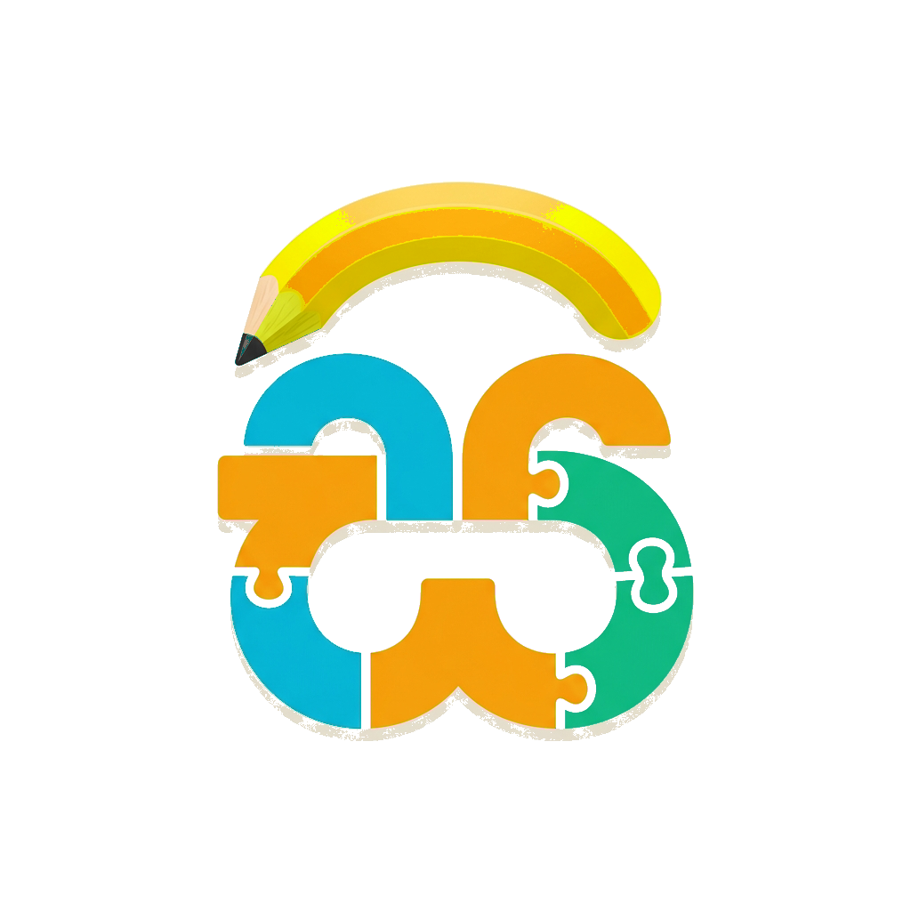

<div align="center">
  

  <h1>Sipsara Research Website</h1>
  <p><strong>Learning Signals, Made Meaningful.</strong></p>
  <p>An AI-assisted, adaptive Sinhala learning ecosystem that turns everyday play into clearer learning support for Grade 1 children.</p>
</div>

---

## 📖 About the Project

**Sipsara** is an undergraduate software engineering research initiative from the Sri Lanka Institute of Information Technology (SLIIT). This repository contains the source code for the official research presentation website, which outlines our problem domains, methodology, milestones, and documentation.

The research investigates how behavioral telemetry, speech analysis, and AI-driven adaptive learning can be unified into a single, cohesive ecosystem for early Sinhala learning support.

## ✨ Features

- **Modern & Premium Design:** A highly responsive, award-winning-style design using a deep navy aesthetic with cyan and amber accents.
- **Glassmorphism UI:** Features blur-backdrop headers, subtle gradients, and glowing accents.
- **Micro-Animations:** Employs Intersection Observer for smooth scroll-reveal animations across all sections.
- **Information Architecture:**
  - `Domain & Gaps:` Outlines the research problems and the gaps in current systems.
  - `Objectives & Methodology:` Details the four core components (Interaction Telemetry, Speech Monitoring, Diagnostic Fusion, Adaptive Tutoring).
  - `Timeline:` Tracks project milestones and assessment marks.
  - `Library:` A categorized hub for project documents and presentations.

## 🚀 Tech Stack

- **Markup:** HTML5
- **Styling:** Vanilla CSS (CSS Variables, Flexbox/Grid, Animations)
- **Interactivity:** Vanilla JavaScript (Intersection Observer, DOM Manipulation)
- **Typography:** Inter & Space Grotesk (Google Fonts)

## 🛠️ Local Development

To run this website locally on your machine, follow these steps:

### 1. Clone the repository
```bash
git clone https://github.com/IsaraSE/sipsara-research-web.git
cd sipsara-research-web
```

### 2. View the website
Simply open the `index.html` file in your preferred web browser. Alternatively, if you have a local server installed (like Live Server or Python's HTTP server), you can serve the directory.

```bash
# Example using Python:
python -m http.server 8000
```
Then visit `http://localhost:8000/`.

## ✉️ Contact Form Setup

The contact form posts to [FormSubmit](https://formsubmit.co/) so it can send email while the site remains fully static. No Gmail password or API secret is stored in this repository.

Before the form can deliver messages:

1. Run the site through a local server or deploy it.
2. Submit one test message through the contact form.
3. Open `kavindugunasena@gmail.com` and click the activation link sent by FormSubmit.
4. Submit a second test message and confirm that it reaches all four team inboxes (check Spam as well).

The team leader's address is the primary FormSubmit recipient. The other three member addresses are included through FormSubmit's `_cc` field.

FormSubmit keeps reCAPTCHA enabled by default. The form also includes a hidden honeypot field to reduce automated spam.

## 📁 Project Structure

```text
📦 sipsara-research-web
 ┣ 📂 images               # Static assets (Favicon, Logo, Hero Image, Team Photos)
 ┣ 📜 index.html           # Main HTML template (All sections & logic)
 ┣ 📜 style.css            # Global design tokens and component styles
 ┗ 📜 README.md            # Project documentation
```

## 👨‍💻 Research Team

This research is conducted by Software Engineering undergraduates at **SLIIT**, under the guidance of our supervisors in the Department of Software Engineering. 

- **C1** — Speech Monitoring (R.K.R.M.S.K Gunasena)
- **C2** — Behavioral Telemetry (K.D.M.D Perera)
- **C3** — Diagnostic Fusion (K.T Olivea)
- **C4** — Adaptive Tutoring (E.M.I.S Ekanayake)

## 📞 Contact

For research collaboration, academic discussion, or project inquiries, contact the student team:

- [kavindugunasena@gmail.com](mailto:kavindugunasena@gmail.com)
- [it22642882@my.sliit.lk](mailto:it22642882@my.sliit.lk)
- [tursholivea@gmail.com](mailto:tursholivea@gmail.com)
- [isaraekanayake123@gmail.com](mailto:isaraekanayake123@gmail.com)

---
<div align="center">
  <small>© 2025 Sipsara Research Team.</small>
</div>
